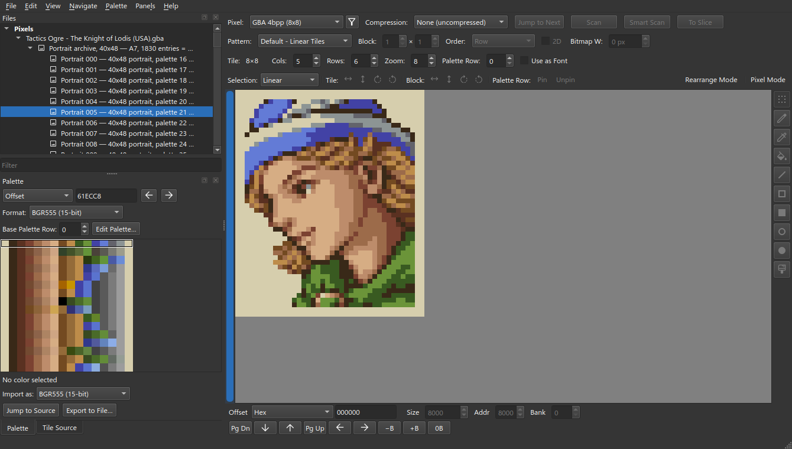
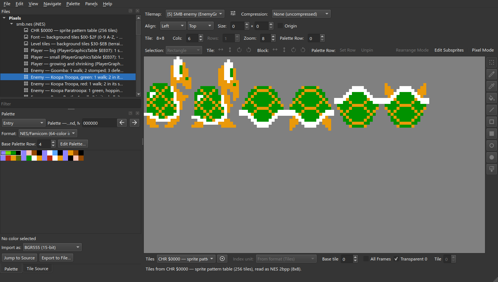

# Sample Projects

## [Tactics Ogre: The Knight of Lodis (USA)](https://github.com/YoriKv/celpix/tree/main/sample-project-public/gba-tactics-ogre)

The 122 character portraits, editable and writable back to the ROM.

The game stores each portrait twice. Battles show the 40×48 portrait, preparations
and cutscenes show a 48×48 one that's kept in a second archive.

| Part | How it works |
| --- | --- |
| Portrait archive | One slice over the game's `A7` archive at `$086E3F3C`. A project plugin, `plugins/compression/lodis_a7.py`, unpacks its entries against the archive's preset dictionary. On save it re-packs every entry, rewrites the entry table and keeps the header and dictionary. |
| Portraits | 122 [nested slices](Compress-and-Reshape), cut from the unpacked archive. Each one is a 40×48 portrait of 30 GBA 4bpp tiles. |
| 48×48 portraits | A second `A7` slice, at `$086C052C`, through the same plugin. Its tiles are already in display order, so they don't need the reshape step. It uses the same palette as the battle portrait. |
| Tile order | The game stores a 40×48 portrait as four sprite pieces: 32×32, 8×32, 32×16 and 8×16. A reshape plugin, `plugins/reshape/lodis_portrait.py`, arranges them into the 40×48 portrait. It puts them back in stored order on save. |
| Palettes | Each portrait reads its own BGR555 palette from the ROM, by offset. |

## [Super Mario Bros. (World)](https://github.com/YoriKv/celpix/tree/main/sample-project-public/smb)

Every sprite the game draws, as 36 [sprite maps](Sprites) with 113 animations.
Each piece's tile can be changed and written back to the ROM.

The game stores very little of a sprite as data. A player frame is 8 tile
numbers and an enemy frame is 6. Where each piece goes, which way it faces and
which palette it uses are all decided by the game's drawing code.

| Part | How it works |
| --- | --- |
| Sprite maps | A project plugin, `plugins/tilemap/smb_sprites.py`, runs a copy of the game's sprite drawing code over the ROM's tile tables. The result is the frames the game shows. It has four formats: the player, the enemies, eight small objects with tables of their own, and eight objects with no table at all, whose tile numbers are written into the drawing code itself. |
| One table, many maps | The 16 enemy maps all read the same 319 bytes. Each picks its enemy with the plugin's **Enemy** input, and the three player maps pick big, small or the size changes the same way ([Plugin Inputs](Plugin-Inputs)). |
| Animations | Each map's animations come from the game's own timers: walk steps of 2, 4 or 7 frames by speed, Goomba's walk flips every 8 frames, Bowser's legs swap every 32. The map's name lists them in order. |
| Editing | In **Edit Subsprites**, pick a piece and change its tile. That writes the one ROM byte the tile came from, and every piece drawn from that byte follows. Positions, flips and palettes are decided by the game's code, so they can't be changed. Pixels are edited on the sprite pattern table. |
| Tiles | Three sheets from the CHR ROM: the 256 sprite tiles, the font (background tiles `$00`-`$2F`) and the level tiles (`$30`-`$EB`). |
| Palettes | Ten screen palettes, each a [composite](VRAM-Windows) of the ROM's own palette bytes: an area's palette list, its backdrop colour and the player's colours. Changing a colour writes it back to the table it came from. |
